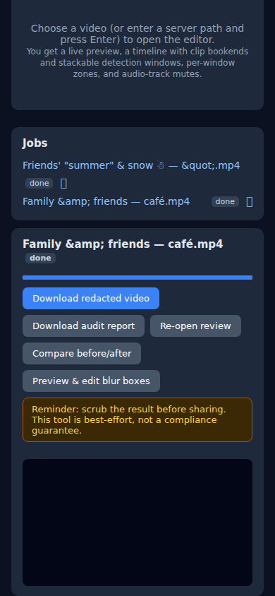
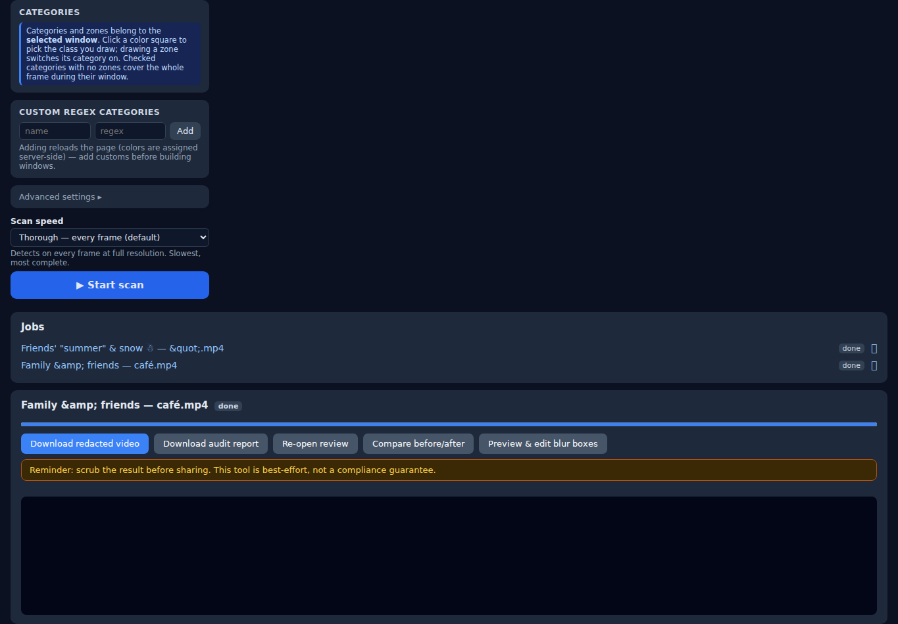

# Task 119 — preserve literal filenames in ordinary jobs UI

Status: implementation and local verification complete; fresh review is owned by the supervisor. No publication or adoption. Branch `pr/literal-job-filenames`, native checkout `/home/tahv0/.codex/worktrees/c832/OpenScrub`.

- Exact base: `e21ebdf6e3ee46e6c65050dc956a9a3459152269`.
- Candidate head: `f399ebe1bd3c17561b44c06f7169a61e21becb43`.
- Runtime source: `openscrub_web.py` SHA256 `62aa7080eb2667f0d5a7c06e5be160ffe8aa5d8d72d7a6df0dc436a90ec33090`.
- Owning tests: `tests/test_job_filename_display.py` SHA256 `d63e48116264ea247cda2d619fd25bf641a05ce8f68a92076a657601a87346dd`.
- Engine unchanged: SHA256 `0e4f0f9a7846080f591038d021aaf3ca6f01201d83ac32bbdc273f53d5067ee7`.

The accepted name `Family &amp; friends — café.mp4` previously displayed as `Family & friends — café.mp4` in both the ordinary job link and detail title. A small local `jobNameHtml` helper now serializes only those two HTML text interpolations. Ampersands are escaped first, preserving literal entity-looking text without decoding or stripping it. The helper is appropriate for these text contexts; it is not a general attribute sanitizer. Existing local transcript escaping deletes characters and was unsuitable for literal filename preservation. No reusable preserving escape helper existed at the base.

Production change is nine lines in `openscrub_web.py` (a comment/helper and two interpolation replacements). The new eight-case owning regression file evaluates the actual emitted `loadJobs` and `shellHtml` functions through Node, then checks parsed text and existing link/title structure. Two actual Flask intake tests pin accepted names, options metadata, input storage paths, list/detail names and ordinary video/report download headers/bytes. Worker scheduling is controlled in those route tests. `pyproject.toml` includes `tests/` in the sdist, and `CONTRIBUTING.md` calls for the full discovered suite and documents the optional Node evaluation requirement. No dependency, framework, new product module or layout change.

Upload acceptance is explicitly separate from submitted filenames: the stable upload submits `folder/Family &amp; friends — café.mp4`, and the actual route accepts/stores `Family &amp; friends — café.mp4`. Server-source intake submits an absolute path under the task-local media root and accepts the existing basename. The browser uses a second accepted name `Friends' "summer" & snow ☃ — &quot;.mp4`. Existing basename normalization, extension handling, job IDs, tooltips, selection state and stored metadata are unchanged. Video/report names stay `Family &amp; friends — café_redacted.mkv` and `Family &amp; friends — café_audit.json`.

## Verification

All application execution used prepared actual Python 3.12.16 or 3.9.25, OpenCV 4.14.0; Node 22.22.1 and existing Playwright/Chromium. Final mutable settings, model/cache/profile, jobs, source exports, installed targets, fixtures and build outputs used `/tmp/openscrub-task119`; the initial Chromium-profile exception and correction are disclosed below. `sitecustomize.py` applies path/write/outward-network isolation before direct server and CLI-child execution, not merely via pytest. Models/settings/certificates are retargeted by task configure; cached YuNet was copied under the task root. Installed-only filtering removes editable native/original/export imports. Base/native/floor/installed imports and source hashes are asserted. Pytest invocations were serial with distinct basetemps.

| Gate | Evidence |
| --- | --- |
| Stable initial benign RED | Four expected entity-text failures (both surfaces), four controls pass; `red-stable.log` |
| Exact exported-base independent RED | Four expected failures, two quote controls pass; source hash/path asserted from empty task runner; `exact-base-red.log` |
| Native owning GREEN | Eight passed; `green.log` |
| Normal full discovered suite | 140 passed, 2 environment-induced HTTP 507 failures in the complete 55.31s run; both failed tests pass in a targeted 2-case rerun after real disk recovery. No fabricated 142-pass full result. |
| Applicable actual Python 3.9 owning checks | 8 passed on actual Python 3.9.25/OpenCV 4.14.0; final owning file, unique basetemp |
| Installed owning checks | 8 passed against installed wheel modules; final owning file from extracted sdist, editable paths filtered |
| Evaluated JavaScript parse | Actual Flask index scripts extracted after Python string evaluation; both pass `node --check`; retained scripts/hashes |
| Offline package | Cached backend only; sdist built, extracted, wheel built FROM extracted sdist; six product modules, test file, test_openscrub and pyproject bytes match; wheel Python floor >=3.9 |
| Installed CLI/web/default smoke | Both installed CLI help children exit 0; five actual Flask test-client GETs 200; complete engine parser defaults equal exact exported base; installed source paths/bytes asserted |
| Actual native browser | Actual upload/server-source/list/detail/log/download/report routes; A→B→A list clicks, literal DOM/link/heading accessible text, existing heading children/selection and normal download names/bytes pass; errors/warnings empty |
| Actual packaged browser | Installed desktop interaction/download flow passed; mobile title/layout checks and screenshot passed. Relevant JS/console errors/warnings were empty; desktop downloads retained exact names/bytes |

Browser plugin and browser skill were absent, so the frontend-testing-debugging skill's regular Playwright fallback used the prepared installation with no new download. URL `http://127.0.0.1:18489/`, title `OpenScrub`, Chromium `159.0.8154.6`, viewports 1365×950 and 390×844. App identity, meaningful page content, no overlay, console health, screenshot review and target interaction proof checked. Screenshots show the literal list/title text and retained wrapping/layout at both sizes. Unicode text is checked through exact DOM/accessibility text; installed environment font glyph appearance is not a cross-platform typography claim.

The standalone QA server uses the actual product app/routes but replaces worker enqueue with a clearly labeled synthetic done/output phase fixture and disables only the auxiliary remote update-check handler. There is no claim of a real scan/render; input/output bytes are synthetic route fixtures. Tests' controlled fetch responses in the Node emitted-function harness are separate from actual Flask and listening-server/browser evidence. No P01 streaming Save As or P02 output choices changes or validation.

## Failures, corrections and limits

1. An initial upload test submitted a lone Windows backslash inside a multipart filename. The existing multipart parser accepted `folderFamily...`, rather than the assumed basename. This was an incorrect fixture expectation, not product RED. The stable fixture uses forward directory separators; normalization was not changed. Initial log retained.
2. The first full-suite process ended exit 143 after 30 dots without a pytest summary. Cause remains unexplained. No test overlap or reused basetemp; no task harness process-group termination code. The command schema exposes yield duration but no explicit command timeout. The incomplete log/session metadata are retained, and no result is claimed from it. The supervised run used its own PTY/session and fresh basetemp.
3. The supervised full suite reported `140 passed, 2 failed`: `test_upload_cap_configurable_and_413_explains_the_way_out` and `test_server_path_intake_guard_precedes_size_lookup`. Both returned existing HTTP 507 low-storage refusal instead of their expected 413/400 because `/tmp` had only 1,033,969,664 bytes free, below unchanged 1 GiB headroom. Initial packaged browser upload also returned 507. The supervisor recovered real headroom by removing two verified inactive Task113 raw JSON duplicates only after verifying lossless archived and committed copies; recovery proof is retained. Both failed suite tests then pass with the real `_disk_free` unchanged; final floor/installed owning checks and installed browser pass. The full suite was not repeated, and its recorded 140-pass/two-environment-failure summary remains explicit.
4. Initial native Playwright used the default `/tmp` transient Chromium profile, while the Python server was correctly task-isolated. Self-review corrected the Node harness to set `TMPDIR` to the task root before loading Playwright and to close the owned browser on assertion failure. The same narrow native flow was rerun and passed, and final installed/browser evidence uses task-local temporary paths. Initial successful native logs are retained separately.
5. The first offline build dependency check found missing `tomlkit>=0.11.1`. Added the already-cached wheel to task-local backend tools, then sdist and extracted-sdist wheel succeeded. No shared environment or network install.
6. Localhost listening/browser launch and native worktree edits/Git writes used the already-authorized escalation path. The first un-escalated server socket attempt was rejected by sandbox; no application behavior claim from that setup attempt.

Only harmless spaces, apostrophes, quotes, ampersands, Unicode and literal entity-looking text were used. The earlier executable-filename research probe was platform-blocked and has no runtime report; it was not retried or worked around. This task provides literal-display correctness evidence only, not exploit validation, broad security certification, upstream acceptance, browser/platform coverage beyond the recorded Chromium sizes, or model/render quality/performance evidence. No heavy benchmark, new model, user data or publication.

Full commands, source/package identities, scripts, isolation hooks, complete relevant results and screenshots are in `task119-evidence/`. Media, environments, installed targets and source-export trees are excluded. The complete runtime and test source are bound by the retained hashes and candidate commit. Self-review inspected the complete product diff and `git diff --check`; fresh independent review follows through the supervisor.

## Browser QA checks

Coverage clarification from independent review: native and installed selection/intake/download interactions ran at desktop width. Mobile checks verified the selected title and captured layout; they did not repeat that interaction loop.

| Check | Native and installed final result |
| --- | --- |
| Page identity | PASS: localhost route and OpenScrub title |
| Meaningful content / blank page | PASS: application body, Jobs list, detail card |
| Overlay / script health | PASS: no framework overlay; no pageerror or console error/warning |
| Accessible text / structure | PASS: exact accepted link/heading name; one detail card; existing badge/ETA children |
| Interaction loop | PASS: list upload A → server B → upload A; CUR, heading and download route follow selection |
| Ordinary downloads | PASS: existing video/report buttons retain suggested names and synthetic body bytes |
| Screenshot review | PASS at desktop1365×950 and mobile390×844 for the affected surface |

The Browser plugin was unavailable; a future Browser installation would allow these checks inside its integrated session, but no plugin installation is needed for the retained scoped evidence.

## Screenshots

