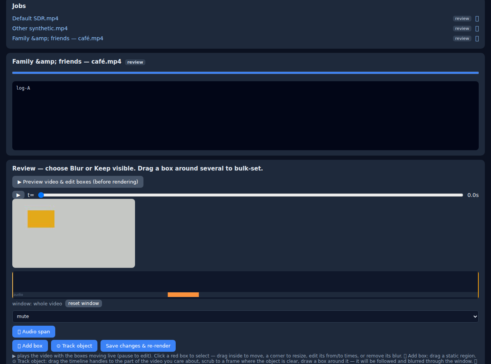
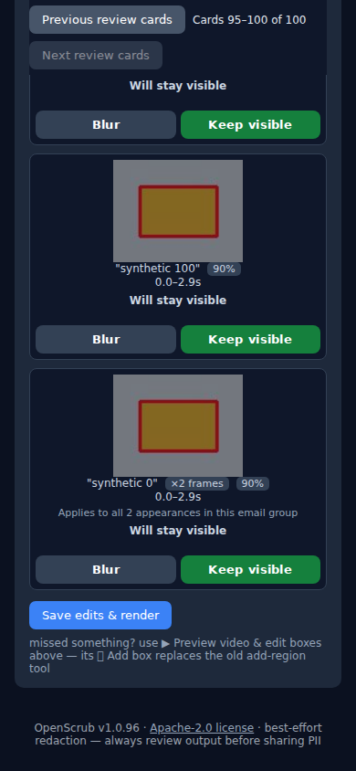
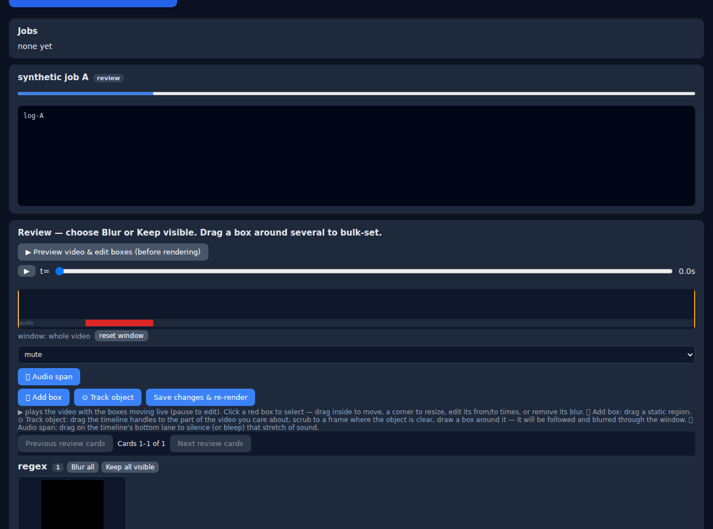

# Task654 — reviewed browser composition gate

Implemented locally for fresh independent root review. Status: **DONE_WITH_CONCERNS** for this bounded intermediate gate. Remaining concerns are retained verification/setup failures, the explicitly bounded platform/control coverage, and inherited accepted minors; there is no known unresolved failure in the selected acceptance checks. Final whole-C01 acceptance and renderer publication remain separate gates.

## Frozen delivery identity

- Assigned isolated checkout: `/home/tahv0/.codex/worktrees/c832/OpenScrub`, branch `integration/upstream-focused-browser`.
- Reviewed core base: `117e41ac5ee857a6b367caf6ccbd479d78989ff2`.
- Final clean head: `00480c7e42ddb329f4dde9599c256555f2dabcf0`.
- `integration/upstream-focused` remains at the reviewed core base. No standalone contribution branch was changed, no renderer work started, and nothing was published or adopted into user data.
- Final engine SHA256: `a959248b4591abb819ae017d3bb5626e51af18aafbc9b48f9af1053f72852ec0`, unchanged from the reviewed core.
- Final web SHA256: `ce05392a115b7cfed11821f51b406cca7e4c5cff118d5876586ad43047897d17`.
- New private `job_logs.py` SHA256: `63d08c124db019b120bb17efc64706d910f1d831f8ccfd9c1ba124368643d1b8`.
- Evaluated APP_JS SHA256: `9790e7252f2552d8e2b9d5cccc71e89f1bfa2745960c73f799a0d41d660c4eb4`; PAGE SHA256: `182fce408ec7c51911eb8c84f4735e3f8d2094809660e9d33371578d48dceca1`.

The [source manifest](task654-evidence/source-identities.json), [per-attempt commands](task654-evidence/commands.md), [structured results](task654-evidence/commands.json), [self-review](task654-evidence/self-review.json), and [package manifest](task654-evidence/package-identities.json) bind the actual files, package parents/leaves, tests, fixtures, recipes, tools and adapters. The initial preflight is explicitly a pre-composition inventory. Each retained run has its own actual preflight and generated runtime config; later configs at a reused filename do not replace an earlier attempt's identities.

## Whole-patch provenance and conflict resolution

All seven originals were applied whole with `git cherry-pick -x`, in the required order. Exact full SHA mappings, all applied patches, conflict inputs and cumulative resolution are retained under [assembly/](task654-evidence/assembly/original-to-composed.json).

| Owner | Original | Composed |
| --- | --- | --- |
| N11 literal filename | `f399ebe1bd3c17561b44c06f7169a61e21becb43` | `e25c3f57fefdd99a653eda1dfa77a94f80d92b57` |
| P16D resize/Play | `47e9f6d5614365e00d899c87df6c209cd7aaabf6` | `823be0821f91abcbaa3b8abef9d34ad39a1cc617` |
| P09 card/thumbnail ownership | `0c2b98e9e136abcd472bdda59cecaf546775ea4e` | `c771b907f04b42bbffe28633fcd8802a483a8d84` |
| P09 restoration/order correction | `fe20dff7b73efb5afdbf3130e75a19c8b35ecba3` | `6f83046c1036169a4cca4c015b5fe0ef4bec202c` |
| P12B backend JobLog | `2c7f2530893cb2ecd20dfe7803b6301ea34f9f9f` | `47c0e577a7546e4db63bda8da66f300066b48e0a` |
| P12C recent browser log | `4670641cb8e53e6daa6f77fb505397bfdb6733b8` | `39d05b664c74960d3530e6cb5a6be3401b2edf0c` |
| P12C portable-runner correction | `f44e0b786ad065010fbfd2b8328350bde44116ec` | `0d8df87042d795e59e320bb4847d7a68fcee6e05` |

N11's text escaping was inserted beside the current P03/P07 owners, retaining C01 export filename metadata. P16D disposal was combined with current polling and view fences rather than restoring the obsolete interval path. P09 retained complete descriptors/membership and added its own independent load identity beside current `AUTO_REVIEW`/`REVIEW_REQUEST` checks. Save completion retains P07 submitted-value acknowledgements and P09 review-owner fencing.

P12B uses `JobLog` in current new and both recovery constructors, and in argv sanitization. `job_public` preserves export names beside one atomic log snapshot. The scan's existing `_pregen(jb=job, video=thumbnail_owner.source)` and cleanup/error ownership were retained. The callback fixture now invokes the actual report publisher, uses a registered input, mutates the later live source, and asserts the captured leased source and original log owner. Other log systems retain their separate ownership.

One private init and existing recursive private/test/benchmark includes were retained. Incoming redundant private-package Docker COPY/include lines were removed during conflict resolution. The resulting three Dockerfiles and pyproject are byte-identical to the reviewed core. README/CONTRIBUTING/benchmark guidance was combined rather than replacing unrelated sections.

No P07/P02/P03 prerequisites, local verification tooling, rejected P11D, or unrelated P/G/R patches were repicked.

## Demonstrated combined runtime fixes

The composed owners exposed actual removal-boundary defects. These have direct meaningful pre-fix failures; composition alone was not assigned artificial RED evidence.

1. `fb9d59b` froze two regressions against the seven-pick runtime. Both failed: a retaining `showPanel('boxedit_rev')` nulled its mounted editor/gesture, while successful save/render removal retained the editor owner on removed review DOM. The narrow fix in `61dbb31` introduces `beUnmountIn(root)` and invokes it only when a replaced/removed subtree contains the mounted canvas. It pauses the removed owned video, disconnects its observer and releases gestures. Retained review/editor panels keep their owners. Actual editor replacement occurs after current job/view/editor fences; stale awaited editor loads cannot dispose the current mount. Review replacement and successful render teardown use the same containment boundary. Both regressions then passed.
2. Self-review found phase-driven `actions.innerHTML` replacement can remove a standalone editor under `beslot_done`. Root approved a separate direct regression in `46a5b42`; it failed on unchanged pre-fix runtime. `a4649a2` adds a single `beUnmountIn(actions)` immediately before that replacement. The complete polling Node file plus the two retaining/removal controls passed 37 cases on actual3.12 and actual3.9.

These are generic runtime fixes for Austin. They belong with the P09/P16D compatibility delivery when those prerequisites are rebased/accepted, with their regressions visible to reviewers. They must not disappear as test-only integration bookkeeping. Their original standalone branches and historical evidence remain unchanged. No new backport branch or external PR was created here.

Other local commits adapt fixture APIs, add the bounded combined browser fixture, and correct the P03 browser fixture's explicit virtual-window/paused-clock setup. Exact old/new fixture bytes are retained in [fixture-identities.json](task654-evidence/fixture-identities.json) and `fixtures/`.

## Verification, with revision limits

All allocating work used bounded external development admission. Private local admission code/config/policy/receipts were kept outside this product evidence. The reviewed shared helper and prepared environments were unchanged. Every workload used a clean explicit prepared3.12 controller, `login:false`, task-owned profile/cache/TMPDIR/settings/jobs and unique serial runs. Socket, browser and listening phases selected escalation at their original invocation. There were no installations, downloads, parallel runtime owners, timing slots or benchmark/media-matrix replays.

| Gate / actual revision | Result |
| --- | --- |
| First frozen affected actual3.12 selection, `61dbb31`, web `4ba3f35…` | 346 passed / 9 fixture failures out of 355 selected cases; retained in full. |
| Three corrected fixture files, `a3d0f0d`, same web bytes | 47 passed / 7 remaining fixture failures. Complete polling Node owner file passed its 34 cases here. |
| Final job-log/filename files, `20d9f29`, same web bytes | 20 passed. |
| Actual3.9 full affected selection, `20d9f29`, same web bytes | 355 passed, Python3.9.25. This precedes the final one-line phase-actions runtime fix. |
| Initial subtree RED → GREEN | 2 genuine failures on `fb9d59b` → 2 passes under development policy on the exact committed `61dbb31` runtime bytes. |
| Phase-actions RED → GREEN | 1 genuine failure on `46a5b42` → 37 complete polling/retaining/removal passes under actual3.12 development policy, then 37 frozen actual3.9 passes at `a4649a2`, web `ce05392…`. |
| Selected browser first attempt, `a4649a2` | 9 setup failures / 1 actual default SDR control pass; browser launch never reached application validation. |
| Corrected selected browser attempt, same runtime | 8 passed / 1 P03 offscreen-card fixture timeout. All six complete P12C retention tests, bounded backend browser and combined interaction test passed. |
| P03 explicit scroll attempt, `6697883`, same runtime | 1 paused-clock fixture timeout; retained. |
| Final P03 browser node, `00480c7`, same runtime | 1 passed after explicit 50ms controlled-clock advance; before/after scheduler diagnostics retained. |
| Final actual3.12 and actual3.9 source audits | Exact source/PAGE/default identities, 71 parser fields and `node --check` passed. |
| One offline package, final `00480c7` | Exact 74 declared sdist/extracted files and 14 wheel files passed; installed source/default/PAGE, CLI/web help and actual listening server passed. |
| Final source self-review | Clean assigned worktree, `git diff --check` exit0, reviewed core ref unchanged. |

The 346 and 355 earlier passes are **not** relabeled as final-head full runs. [self-review.json](task654-evidence/self-review.json) retains the exact one-line web difference after the floor selection, and proves the web runtime is unchanged after `a4649a2`; final browser, floor polling, audits and package checks cover that final runtime. Later commits affect only the single browser fixture. No complete discovered suite was run at this intermediate gate; final whole-C01 full discovery remains after renderer integration.

The affected selection comprises the complete JobLog, literal filename, polling Node, thumbnail scheduling, review choices/save failures, Save As progress, job lifetime, response lifetime, source allowlist lifetime, report transactions/serialization/roundtrip and manual replay owner files, plus the two combined teardown controls. The exact fresh-child stdout adapter is byte-identical to Task16330's reviewed scoped adapter, SHA256 `0d5a47ad5c5b54ee980473170a2177eb79d47ca6a972d0872926b0fde4d90f83`. It validates and preserves startup records only for the unchanged exact JSON-only child test; it does not suppress general output.

P01's complete emitted-JS suite still checks accepted completed writes, known/unknown totals, waiting/finalizing, and initiating-job progress ownership through a job switch/remount. P03's owner checks retain deadlines, cancellation, single-flight cycles, retry and cursor/body authority. Complete P02/P07/P09 checks retain hidden/full membership, mixed choices, stable order/restoration, submitted-value acknowledgements, newer opposite drafts, failed-save/audio semantics, four unsettled body slots and released URL/listener ownership. Existing complete FILES/source/response/operation/report/replay checks remain bound to their actual recorded sources.

## Actual browser and tiny media boundaries

Browser plugin not available. Approved fallback reused existing Playwright and Chromium headless159.0.8154.6, without dependency changes. The main flow was actual loopback `/` → production review/log/thumbnail routes → A→B→A with held HTTP bodies → controlled pagehide/pageshow → ordinary Play → live resize and card-window movement → held real successful save ACK/newer opposite edit → controlled failed save → fresh raw/audio reopen.

The bounded fixture has a tiny 320×180, 30-frame synthetic H264 clip; 102 rows / 101 complete descriptors, including an independent outside-zone row and a grouped pair. At the recorded body-switch boundary, maximum unsettled thumbnail slots were4, normal mounted cards42, and all102 members remained authoritative. Whole-category actions covered unmounted members. The viewport changed from1280×950 to390×844. Editor/canvas/draft/video identities and an unfinished addition survived local card movement; ordinary Play requested metadata itself and playback/transform ownership survived resize/card movement.

The save used the actual production endpoint before its successful ACK body was held. A newer opposite choice remained pending and prevented stale render dispatch. A controlled423 retained the draft. The final actual save preserved all102 raw rows and untouched fields, unknown metadata and chosen audio; a fresh page reopened the complete persisted choices/audio without a pending-choice draft. The following render dispatch was deliberately refused409 for this intermediate persistence check. The separate default SDR control invokes actual `_run_job`/render, decodes320×180 output and checks complete raw/unknown/audio report preservation; only dispatch scheduling is synchronous in that fixture. This is not a claim that the browser's final save dispatched a real background render. Complete background queue/lifetime owners were exercised separately.

Page identity/title, meaningful nonblank content, no framework overlay, interactions and screenshots were checked. Combined page errors were zero. Its three console diagnostics exactly correspond to injected thumbnail503, save423 and render409. P12C owner tests separately verify actual layout/scroll/selection/reflow, represented-text bounds, legacy defense and current-owner cleanup. P03's final screenshot/JSON covers real preview/help alongside controlled request deadlines and lifecycle wake behavior. Screenshots were visually inspected.

Pagehide/pageshow and one thumbnail retry are controlled events/responses. The P03 visibility property is also controlled. Native BFCache/visibility, other browsers/platforms, native decode termination and audible audio rendering are not claimed. The synthetic clip has no audible track; audio evidence concerns draft/report ownership.

## Packaging and defaults

The final source config pins96 source/test/recipe identities and all selected module parents/leaves. Packaging inventories derive from actual pyproject recursive includes rather than the broader verification inventory. One offline sdist→safe extraction→wheel-from-extracted-sdist→no-deps installed-target pipeline verified74 exact source/test/benchmark assets and14 exact runtime/registry files. `openscrub_internal/job_logs.py` is byte-identical through source, sdist, extraction, wheel and guarded installed import. All other private helpers remain present.

- Sdist:730,144 bytes, SHA256 `16676af3979f3672269eed496ff3d39d10352bcde543ae5e8275caf10ecec5ee`.
- Wheel:470,902 bytes, SHA256 `9892ee6a3bde035ab561d9b7995951b40fc9d1c47b9efa57248d6169e5ad500f`.
- Python metadata remains `>=3.9`; actual floor execution used3.9.25, not a metadata inference.
- Installed CLI/web help and real installed `openscrub-web --http --host 127.0.0.1` served `/` and `/api/jobs`, with exact installed imports/default paths and zero leftover server status. No bootstrap/source checkout was used as an installed product import.
- Source/installed PAGE/APP_JS and all71 parser values match; Austin `coverage=tight`, `out_quality=archival`, `mode=blur` and all other defaults remain intact.
- Actual3.12.16: OpenCV4.14.0.94, NumPy2.5.5, Flask3.1.3, Pillow13.0.0, cheroot11.1.2, pytest9.2.0. Actual3.9.25: same OpenCV/Flask/cheroot, NumPy2.0.2, Pillow11.3.0, pytest8.4.2. These are recorded separately in the environment manifests.

Docker recursive COPY, frozen static import traversal and updater recursive sdist-file copying were inspected only. All six named recipe/updater files are unchanged from reviewed core; no Docker build, frozen executable or updater was executed.

## Retained failures and limits

All available complete attempt logs and exact source/fixture identities remain in compact evidence. Material failures are:

- Initial local admission was attempted inside the ordinary filesystem sandbox and refused writing its private maintenance lock; the same untouched admission ID succeeded with authorized escalation before source writes. Raw private local records remain outside this product archive.
- The first N11 resolution staging command named a nonexistent `tests/test_literal_job_names.py`; Git refused it, no commit occurred, then the actual `tests/test_job_filename_display.py` staged change was retained and the resolved pick continued.
- The nine native fixture failures came from direct-JOBS_DIR unregistered input, an obsolete publisher-less write-report double, overly broad emitted-JS slicing and missing scheduler layout primitives. The next seven failures exposed the new exact logStatus markup and a queued replacement rejected by current edit admission. Corrections preserve actual source/publisher/leases and original assertions. The initial filename child stderr was not exposed by that original fixture's `check=True`; the complete parent failure is retained.
- The first browser attempt omitted the existing prepared library directory (`libnspr4.so` launch error). The caller had not created helper-assigned `run/browser`; six retention log writes then masked their child startup output. The complete pytest diagnostics and available raw launch log remain. This was setup failure, not runtime RED.
- The final P03 preview action initially targeted a virtualized card below the expanded Advanced settings. Explicit real scroll then required advancing the fixture's already-paused clock so P09's requestAnimationFrame could reconcile. Both failures, the corrected source and before/after diagnostics are retained; no product scheduler bypass was added.
- The package controller emits the accepted Task901 safe-extraction deprecation warning. No helper change or rebuild was made.

Preserve the accepted P12C dense-layout budget exceedance and initial-cost tradeoffs by reference to [Task1203](task-1203-report.md), plus the original [Task9](task-9-report.md) restoration/visibility/platform limits and [source handoff](../research/fourth-integration-source-research.md). Task119 viewport wording, Task115 key-order comment, Task164 classified canvas readback warning, Task652 optional ffprobe/encoder prerequisite nit, and Task901 extraction warning remain accepted minors by reference; this gate does not erase them.

Backend JobLog's2,000 entries/512KiB UTF-8/8KiB entry and browser800 entries/2MiB represented-text bounds retain their distinct meanings. Complete metadata, explicit selection, browser/native caches and other process state have separate costs. There is no new speed, RSS, p95, accuracy, total-memory, universal-platform, crash-atomicity or native-interruption claim.

No standalone log/DOM/smoothing/aggregation timing or benchmark was rerun. Portable-runner code/tests/recipes were retained and byte-checked in packaging; its measurement recipe was inspected only. Large media, environments, exports and installed/source-extraction trees are excluded from compact evidence and remain task-owned scratch for root review.

## Review and next gate

Self-review confirmed actual removal boundaries, current request/view/cycle fences, unchanged Python core/FILES/report helpers, exact seven-patch provenance, source/package bytes, clean source and unchanged working core ref. The complete public-facing local PR record is [task-654-pr.md](task-654-pr.md). Root assigns fresh independent review before any integration-ref change. No renderer task, final C01 acceptance, additional branch/backport, adoption or publication is implied.

## Screenshots

