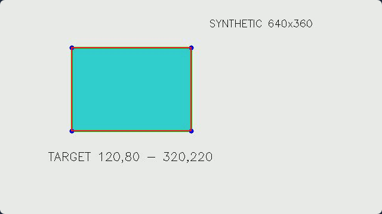
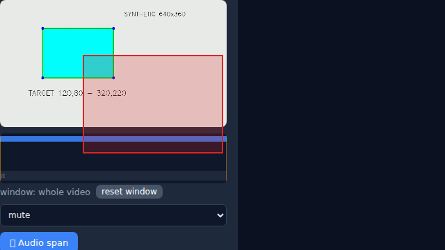
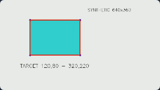

# P16 editor live-resize baseline research

**Finding: the demonstrated editor alignment defect predates P07a.** It reproduces with identical painted-pixel errors on the complete pinned baseline and P07a exports. P07a is not the introducing change for this observation. Research completed 2026-11-17; no product fix, Git-state operation, dependency/model download, active-worktree runtime, or broad UI audit was performed.

## Scope and provenance

Requirements: [editor-resize-baseline-brief.md](editor-resize-baseline-brief.md). Original observation: [task-71-report.md](../delivery/task-71-report.md), “Real browser and real engine evidence,” and its `/tmp/openscrub-task71/browser.cjs`, `newer-pending-desktop.png`, and `newer-pending-mobile.png`. The original screenshot/scenario was read and inspected: deferred save plus newer drafts was followed by a viewport change, with image shrink and stale canvas outlines. The minimal reproduction below needs neither saving nor pending edits, so it works unchanged on both versions.

| Version | Exact commit | Export/runtime source |
| --- | --- | --- |
| Baseline | `e21ebdf6e3ee46e6c65050dc956a9a3459152269` | `/tmp/openscrub-editor-resize-baseline-20261117/baseline` |
| P07a reviewed head | `92124753736e287ac800af91f0ac96f3e96c01be` | `/tmp/openscrub-editor-resize-baseline-20261117/p07a` |

Each is a full `git archive SHA` export, not an extracted `APP_JS` fragment or hybrid checkout. A post-run byte comparison verified all 113 baseline / 114 P07a archive files against their pins. [source-provenance.json](editor-resize-baseline-evidence/source-provenance.json) records tree IDs, export digests and exact `openscrub_web.py` hashes. The active Task620/native worktree was never imported or served.

Separate loopback servers served the real Flask page and real media/report/boxes routes at `http://127.0.0.1:18561/` (baseline) and `http://127.0.0.1:18562/` (P07a). `sys.path[0]`, server cwd, `openscrub_web.__file__`, and `openscrub.__file__` explicitly point at the matching complete export. [Baseline identity](editor-resize-baseline-evidence/baseline-server-identity.json) and [P07a identity](editor-resize-baseline-evidence/p07a-server-identity.json) record imports, source hash, PID and isolated job directory. Only writable settings/model/job roots and unrelated update-check metadata were isolated in the launcher; product files and production editor functions were unchanged. No scan or render worker was started.

All synthetic jobs/media live under `/tmp/openscrub-editor-resize-baseline-20261117/runtime/{baseline,p07a}`. The deterministic 2-second, 10 fps, 640×360 video has an identifiable cyan rectangular target, green border, blue corner markers and coordinate text. A synthetic report has one enabled rectangle `cbox=[120,80,320,220]`, active over `[0,2]`, with `ox=oy=0`. Real `boxes_at` returns that source rectangle; real `frame_at` decodes the synthetic video. [source.png](editor-resize-baseline-evidence/source.png) shows the fixture before video encoding. No user footage or external model/network evidence was used.

## Environment and execution

Browser plugin not available in the skill/tool catalog; the brief authorized the existing regular Playwright fallback. Reused the installed `/tmp/openscrub-save-as-20261116` Playwright/Chromium/shared libraries read-only: Playwright **1.65.1**, Chromium **159.0.8154.6**, headless Linux, DPR **1**, Node **v22.22.1**. Python **3.12.16**, OpenCV **4.14.0**, supplied `/tmp/openscrub-baseline-20261116/venv-opencv4` environment. Exact runtime values are in [results.json](editor-resize-baseline-evidence/results.json) and server identities.

Flow: full OpenScrub page → synthetic job → ordinary review “Preview video & edit boxes” → desktop frame → live mobile resize with editor retained → ordinary redraw → scrub → close/reopen → correctly mapped overlay.

For each version, in a fresh context:

1. Navigate to its own server and click `synthetic-resize.mp4`, then the ordinary Preview button. Wait for the real image and one production editor box.
2. At **1365×1000**, record image/canvas CSS and intrinsic geometry, `BE.scale`, source box, and actual production canvas pixels. Capture full page and editor screenshots.
3. Call `page.setViewportSize({width:390,height:844})`; wait two animation frames plus 100 ms. **No reload, scrub, save or editor remount.** Image/canvas identities remain unchanged; zero image load events and zero frame/boxes requests occur across this resize.
4. Measure and screenshot before pointer interaction. Click the target's visible center through the real canvas pointer listener, record selected index, then click a blank point to clear selection.
5. Invoke the unchanged production `beDraw()` as a minimal ordinary-redraw check; measure again.
6. Set the ordinary `#beT` slider to `0.5` and dispatch its normal `input`; wait for the actual new source frame and box fetch. Measure and repeat the target-center click.
7. Call the existing production `loadReview()` entrypoint, which closes the editor through `showPanel("review")`; assert no `#beCv` remains. Click the ordinary Preview button again and confirm new image/canvas elements, correct geometry and painting. There is no separate close button invented by this harness.
8. Read the report through HTTP and confirm unchanged source `cbox`; there were **no non-GET browser requests**.

Reproduce using the retained scripts after re-creating the complete exports with the two commands recorded in `source-provenance.json`:

```sh
. /tmp/openscrub-baseline-20261116/env-opencv4.sh
python /tmp/openscrub-editor-resize-baseline-20261117/run.py
python /tmp/openscrub-editor-resize-baseline-20261117/provenance.py
```

[run.py](editor-resize-baseline-evidence/run.py) owns server subprocesses in `finally`; [browser.cjs](editor-resize-baseline-evidence/browser.cjs) closes each browser context and browser in `finally`. [serve.py](editor-resize-baseline-evidence/serve.py) describes source selection and synthetic data setup; [provenance.py](editor-resize-baseline-evidence/provenance.py) performs the archive byte comparison. Copies of all four are retained in evidence. The normal filesystem sandbox initially denied loopback socket creation; the same isolated run succeeded with reviewed sandbox escalation. Research-only harness corrections replaced an invalid viewport screenshot crop with element screenshots and guarded an asynchronous post-remount wait. No application failure was fixed or hidden by those corrections.

## Measured result

**Both versions produced the same values in every state.** Image natural dimensions always remain 640×360. CSS dimensions below are bounding rectangles; integer canvas height explains the small corrected-state rounding difference.

| State, on both pins | Image CSS size | Canvas CSS / intrinsic size | `BE.scale` | Largest painted stroke edge error | Overlay at expected target center |
| --- | --- | --- | --- | --- | --- |
| Desktop initial | 640×360 | 640×360 / 640×360 | 1 | 1 CSS px | RGBA `[219,36,36,56]` |
| Mobile, live resize | 326×183.375 | 640×360 / 640×360 | 1 | **158 CSS px** | **RGBA `[0,0,0,0]`** |
| Mobile, `beDraw()` | 326×183.375 | 640×360 / 640×360 | 1 | **158 CSS px** | **RGBA `[0,0,0,0]`** |
| Mobile, scrub to 0.5 s | 326×183.375 | 326×183 / 326×183 | 0.509375 | 1 CSS px | RGBA `[219,36,36,56]` |
| Mobile, close/reopen | 326×183.375 | 326×183 / 326×183 | 0.509375 | 1 CSS px | RGBA `[219,36,36,56]` |

Expected mapping is computed independently from the image's measured bounding rectangle and natural size: `expectedX = imageLeft + sourceX × imageCssWidth / 640`; likewise Y uses `imageCssHeight / 360`. Actual painted edges come from `getImageData()` on the **real production canvas**, isolating opaque red stroke pixels, then mapping canvas bitmap pixels through the canvas's own CSS/intrinsic dimensions. No drawing function was replaced or instrumented with a miniature renderer.

Relative to the common image/canvas origin, at mobile size:

- Expected rectangle edges: **`[61.125,40.75,163,112.0625]`** CSS px.
- Observed red stroke outer bounds before/after plain redraw: **`[119,79,321,221]`** CSS px. The 2 px production stroke adds approximately 1 px outside its nominal `[120,80,320,220]` path.
- Signed painted-edge deltas: **`[57.875,38.25,158,108.9375]`** CSS px. This is much larger than normal stroke/rounding tolerance.
- Expected target center: **`(112.0625,76.40625)`** CSS px. That point is completely transparent in the overlay bitmap after resize, while it has the production red fill initially and after scrub/reopen.
- Pointer hit at that same visible center selects **`-1`** after resize and **`0`** after scrub. The inverse pointer mapping is stale too; the defect is not merely different element widths.

After scrub/reopen the opaque red stroke spans `[61,40,164,113]`, within 1 CSS px of expected box edges. Screenshots visually confirm red fill/stroke covers the cyan target initially and after recovery, but shifts down/right and over the timeline immediately after resize. The preserved full-page mobile screenshots have a 390 px viewport but a wider document image due to the stale overflowing 640 px canvas; that does not change the measured viewport or target coordinates.

[results.json](editor-resize-baseline-evidence/results.json) contains all five states per pin, raw canvas bounds, CSS/intrinsic geometry, scroll offsets, expected/rendered edges, alpha samples, pointer hits, source report and request guards. [browser-final.log](editor-resize-baseline-evidence/browser-final.log) records the successful run. Both pages have title `OpenScrub`, meaningful content, no framework overlays and **zero page exceptions**. The single console warning per context is Chrome's `willReadFrequently` performance suggestion caused by research `getImageData()` reads. No resource or application errors occurred in the final run. [cleanup.json](editor-resize-baseline-evidence/cleanup.json) confirms both servers were reaped after SIGINT, and `results.json` confirms browser cleanup.

## Actual owner and smallest fix contract

Owner: the **box editor media-to-canvas display transform in `openscrub_web.py`**, not the server's detection or render-mask geometry.

| Responsibility | Baseline source line | P07a source line |
| --- | --- | --- |
| `loadBoxEdit`, responsive image and absolutely positioned unsized canvas | 2221 | 2275 |
| Image `onload`: assign canvas width/height, cache `BE.scale`, draw | 2273 | 2328 |
| Playback start: assign video-sized canvas and scale once | 2306 | 2368 |
| `bePlayStop` → scrub | 2329 | 2391 |
| `beScrub`: load a new image and fetch source boxes | 2481 | 2551 |
| `beDraw`: multiply source box coordinates by cached scale | 2509 | 2581 |
| `beHook`: inverse pointer conversion via cached scale; drag overrides subtract `BE.ox/oy` | 2561 | 2633 |
| `showPanel`: existing editor teardown/remount boundaries | 2669 | 2737 |

These lines refer to the pinned full exports, not the active checkout. Neither pin has a resize/element-size synchronization listener for this editor. CSS `max-width:100%` shrinks the image; a CSS resize does not fire its `load` handler. Canvas bitmap/CSS dimensions and `BE.scale` therefore retain the old values. `beDraw()` faithfully repaints using that stale transform. Scrubbing changes the image source and triggers the existing load-size path, which explains recovery. P07a adds view/editor ownership guards to that load path and preserves drafts, but does not introduce this missing resize synchronization.

A future narrow fix should satisfy this contract:

1. Keep one current, mount-owned transform from the **visible source media** to overlay display coordinates; synchronize canvas CSS/backing geometry and scale when that media's displayed size changes, then redraw without requiring frame reload or scrub. Observing the mounted media/container's size is one candidate; merely CSS-scaling the canvas without updating pointer conversion is insufficient.
2. Drawing and inverse pointer conversion must use the same current transform, including any backing-store/CSS ratio. Preserve source-space detection boxes and manual additions, content-space `BE.ov` with its existing `ox/oy` subtraction, time bounds and save payload/report coordinates. A viewport change must not mutate those values, submit a save, alter masking defaults/padding, or change upstream engine masks.
3. Only derive the transform from finite, positive displayed and source dimensions. This is directly relevant because the existing editor switches visibility between image and video; a hidden/unloaded media element must not publish zero/invalid scale. Existing fractional CSS/integer backing-size rounding needs an explicit tolerance or consistent ratio.
4. Size callbacks must belong to the mounted editor/job/media element and be disconnected or invalidated when `showPanel`/`openJob` replaces it. Preserve P07a's view-generation/editor/element guards. Otherwise a new observer could let an outgoing or hidden editor overwrite the new editor transform. This is a lifecycle constraint for the proposed resize owner, not evidence of an additional observed defect.

No fix was implemented. The measured static-frame reproduction alone does not establish playback-resize behavior; playback's one-time sizing is noted only because it is the adjacent owner of the same transform.

## Remaining gates

Provenance gate resolved: **existing baseline issue, not introduced by P07a**. No change to the reviewed P07a prerequisite is indicated by this finding. The supervisor was notified immediately after the first successful paired reproduction.

A separately authorized P16 implementation should retain this reproduction as a failing alignment case and verify live shrink/grow, correct visible-target hit/add/move/corner geometry, unchanged source/content save coordinates with nonzero scroll offsets, hidden/zero-size handling, media switches and teardown ownership. This research verified static paused-frame shrink, plain redraw, scrub, close/reopen and selection only; it did not drag/save, test nonzero offsets, playback resize, high DPR, Firefox/Safari, native mobile devices, output-render masks, or run a broad suite/build/benchmark. No claim is made that upstream redaction masks are wrong or that a fix has passed.

## Screenshots

The two live-resize crops were inspected and show the same misalignment; recovery crops were also inspected. Full-page context is retained for both live mobile states and P07a desktop. All five crop states per pin are in the evidence directory.






