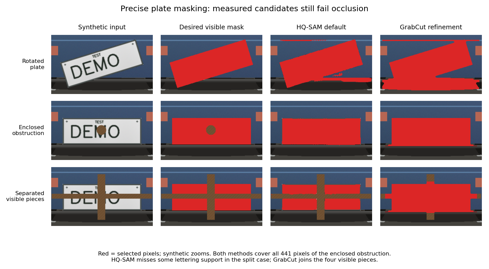

# Precise visible-plate masking: additional backend evaluation

## Decision

**Automatic precise mode remains blocked.** This pass executed a new small
segmentation candidate and two fixed model-free variants, then checked the
segmentation model on independently annotated genuine physical occlusion.
None resolves the required combination of lettering coverage, separate visible
pieces and enclosed occluder exclusions. No production setting or backend was
added, and there is no new implementation PR claiming the objective is met.

The existing compound-mask PR supplies representation/rendering/review support;
it does not automatically discover these masks. The separate narrow-mode PR
retains its documented full-plate fallbacks and SDR-only export limitation.

Red marks selected pixels. The desired column uses known synthetic truth. The
model can follow an angle while still failing the visibility requirement.

## Light HQ-SAM: actual model execution

- Official source: [SysCV/sam-hq](https://github.com/SysCV/sam-hq), pinned at
  `e696978d60352dc9a26b12631cd91781502c6546`.
- Official Tiny checkpoint: [pinned Hugging Face file](https://huggingface.co/lkeab/hq-sam/blob/a3a77cd0a2e5e50eaa76faccf61b964732d9b35f/sam_hq_vit_tiny.pth),
  **42,526,881 bytes**, SHA-256
  `0f32c075ccdd870ae54db2f7630e7a0878ede5a2b06d05d6fe02c65a82fb7196`.
- Source license and model listing: Apache-2.0. No weights are redistributed.
- [Successful CI execution and downloadable synthetic evidence](https://github.com/tahv0/OpenScrub/actions/runs/42056973907).
  Python 3.11.18, CPU PyTorch 2.5.1, two threads; the workflow installs
  `opencv-python-headless==4.10.0.84`, NumPy 1.26.4 and timm 0.9.16.

The input is a correct locator box, not a real plate-detector result. Crop
context is the same fixed 25% horizontal / 35% vertical policy used in the
earlier EfficientSAM experiment. The upstream RGB preprocessing and early HQ
features are preserved. The adapter exposes every raw/combined mask and score,
and its two selected outputs were checked against the official predictor API
on every fixture. Neither prompts nor selection use truth.

The two preregistered selection policies are the upstream single-mask box
output and the model-score-selected alternative among tokens 1–3. A third row
measures a three-pixel dilation of the default output, as a coverage/exclusion
tradeoff. No fallback conceals failed masks in these measurements.

| Twelve synthetic fixtures | Default box | Score-selected alternative | Default + 3 px |
| --- | ---: | ---: | ---: |
| Visible plate pixels missed / 126,352 | 4,247 | 5,401 | 0 |
| Labelled main glyph pixels missed / 21,081 | 12 | 13 | 0 |
| Pixels outside visible plate selected | 2,597 | 1,638 | 20,983 |
| Occluder pixels selected / 8,846 | 669 | 489 | 3,409 |
| Enclosed occluder selected / 441 | **441** | **441** | **441** |

The raw default has five components in the cross-occlusion case where truth
has four, and misses 12 annotated glyph-support pixels. Expansion recovers
those pixels but selects 1,544 of that case's 3,335 occluder pixels. All three
moving-occluder fixtures have zero main-glyph misses in the default output;
this short synthetic sequence is not general temporal validation.

After one warmup, the default run's median encoder/decoder/postprocess latency
was **1,762.9 ms/crop**, p95 **1,815.4 ms**, on that shared two-thread CPU runner.
Alternative API verification calls were excluded from these timings. No GPU
measurement or production ONNX export was attempted after the quality failure.

Raw data: [hq-synthetic-metrics.json](hq-synthetic-metrics.json). The first
runner mislabeled model class `Sam` as `source_revision`; the exact source
commit is correctly recorded separately as `source_pin`. The runner has since
corrected that metadata and added OpenCV/NumPy versions; inference is unchanged.

## Model-free GrabCut screen

The frozen baseline uses rectangle-seeded OpenCV GrabCut, five iterations.
The candidate adds one small closing and bounded thin-hole recovery, retains
all proposal components, and has no fixture-name, coordinate, color or truth
lookup. Thin-hole recovery can also fill a small real occluder, so its limits
are measured explicitly.

| Independent screen | Refined original 12 | Refined all 60 |
| --- | ---: | ---: |
| Visible plate pixels missed | 8 / 126,352 | 9,685 / 631,312 |
| Labelled main glyph pixels missed | 0 / 21,015 | 105 / 105,075 |
| Background outside the full plate selected | 17,386 | 241,199 |
| Occluder pixels selected | 7,156 / 8,846 | 31,424 / 44,678 |
| Exact component/hole counts | 8 / 12 cases | 27 / 60 cases |
| Median process CPU time | 251.1 ms | 261.2 ms |

The 60 inputs are the 12 originals plus four frozen stress families: Gaussian
blur, low contrast, expanded locator boxes and small ink-like occluders. Blur
exposes 105 annotated glyph pixels across the three moving fixtures. Both
baseline and refined variants cover the entire 441-pixel enclosed occluder and
join the four cross-occluded plate pieces.

This ran on Python 3.12.14, OpenCV **5.0.0**, NumPy 2.3.5, one OpenCV thread.
Its glyph rasterization differs from HQ's environment (21,015 versus 21,081
pixels). These are independent rejection screens, not a controlled model
accuracy/speed comparison. The strict zero-pixel diagnostics are descriptive;
the substantive rejection is the whole occluder and fragment/glyph failures.

Data: [classical-synthetic-metrics.json](classical-synthetic-metrics.json),
[frozen method and script hash](classical-preregistration.json).

## One genuine physical-occlusion smoke test

A [public-domain photograph](https://commons.wikimedia.org/wiki/File:Partly_covered_license_plate_of_Thailand.JPG)
was downloaded to scratch and independently annotated **before** model outputs
were seen. The input SHA-256 is
`f0ff367638f798308709b269c81b9323b2a9f825679a0a09e152ec0558b25058`.
Real pixels, identifying crops, transcriptions and the external annotation are
excluded from the repository and public artifacts. Only numeric results are
stored here.

The manual annotation contains three approximate visible components, a 14-pixel
boundary uncertainty band, larger uncertain fringe regions, five certain
visible-glyph-containing patches and three certain occluder patches. All 2,200
pixels of the partial-glyph-containing patch lie outside the uncertainty mask.
The patch is a containing rectangle, **not 2,200 individually labelled ink
pixels**. Counts of certain visible surface exclude the explicit uncertainty.

At both full 2816×2112 input and a 352×264 view, both fixed model-selection
policies:

- Cover the four tested main-region patches, but cover **0 / 2,200 pixels**
  of the patch containing the separately visible partial glyph.
- Leave all three tested pole/curtain patches untouched.
- Give SAM-token IoU regression scores of approximately 0.986–1.001 despite
  the omitted fragment. These scores are neither measured visible-mask IoU
  nor calibrated confidence probabilities, and may exceed one.

The full-input default omits 72,361 of 2,528,609 approximately certain visible
surface pixels. The smaller view's counts are computed after nearest-neighbor
projection into original photograph coordinates. Local latency was about
4.93 s/full input and 2.97 s/smaller view, including encode/decode/postprocess;
there was no separate warmup for this smoke test. The local host warned that
CPU feature detection was unavailable, so these are not benchmark timings.

This single close-up establishes a concrete missed-fragment failure. It does
not establish ordinary road-image quality, plate-locator recall, enclosed-hole
behavior on real imagery or coverage as an occluder moves away. No actual
registration text was recognized or recorded.

Data: [real-occlusion-smoke-metrics.json](real-occlusion-smoke-metrics.json).
The external annotation SHA is recorded there; annotation-only independent
review reproduced the certain-visible area and patch/uncertainty separation.

## What is needed before a production precise-mode PR

1. A method or small model evaluated against **visible** plate masks that retain
   every component and exclude foreground objects. Four-corner training labels
   alone do not supervise those exclusions.
2. Independently labelled held-out real clips covering angles, split pieces,
   enclosed occluders and newly exposed letters, with per-frame evaluation.
3. An error/fallback rule assessed on those held-out cases; current model scores
   fail to flag the observed omitted fragment.
4. Only after useful quality is demonstrated: portable ONNX execution, model
   licensing/pins/notices, timeline/render/review integration, and a separate
   feature PR. Current full-mode behavior stays the default.

This does not remove any original requirement. It records why the missing
automatic precise backend cannot yet be marked ready, and preserves executable
experiments for a future candidate or targeted training effort.
